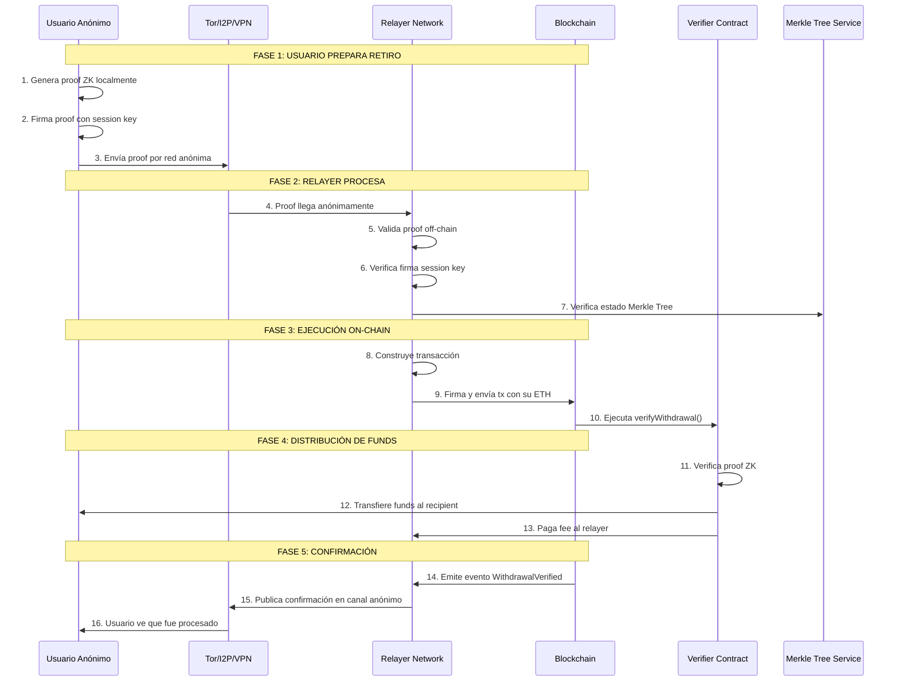

# 🚀 **Los Relayers: El "Cómo" de la Anonimidad Práctica**

## 📊 **EL PROBLEMA QUE RESUELVEN LOS RELAYERS**

```
┌─────────────────────────────────────────────────────────────┐
│               PROBLEMA SIN RELAYER                          │
├─────────────────────────────────────────────────────────────┤
│                                                             │
│  USUARIO ANÓNIMO quiere retirar                            │
│  pero necesita:                                             │
│                                                             │
│  1. Pagar gas en ETH                                        │
│  2. Tener dirección con ETH                                 │
│  3. Exponer IP address                                      │
│  4. Firmar tx con su wallet                                 │
│                                                             │
│  ❌ ESTO ROMPE LA ANONIMIDAD!                               │
│     • Necesita ETH linkeable                                │
│     • Su IP puede ser rastreada                             │
│     • Su wallet firma la tx                                 │
└─────────────────────────────────────────────────────────────┘
```

## 🔄 **SOLUCIÓN: RELAYER COMO INTERMEDIARIO**

```
┌─────────────────────────────────────────────────────────────┐
│              CON RELAYER - ANONIMIDAD COMPLETA              │
├─────────────────────────────────────────────────────────────┤
│                                                             │
│  USUARIO ANÓNIMO:                                           │
│  • Solo genera proof ZK                                     │
│  • No necesita ETH                                          │
│  • No firma transacciones                                   │
│  • No expone IP directamente                                │
│                                                             │
│  RELAYER:                                                   │
│  • Recibe proof vía Tor/anon network                        │
│  • Paga el gas con sus ETH                                  │
│  • Firma y envía la transacción                             │
│  • Recibe fee por el servicio                               │
└─────────────────────────────────────────────────────────────┘
```

---

# 🏗️ **ARQUITECTURA COMPLETA DEL RELAYER**

## 📡 **Diagrama de Flujo Completo**



---

## 🔧 **COMPONENTES DETALLADOS DEL RELAYER**

### **1. API Gateway (Punto de Entrada Anónimo)**
```javascript
// server.js - API del Relayer
const express = require('express');
const app = express();

// Endpoint para recibir proofs anónimos
app.post('/api/v1/submit-proof', async (req, res) => {
    try {
        // 1. Recibir proof anónimamente
        const { 
            proof,           // Proof ZK-SNARK
            publicInputs,    // Inputs públicos
            recipient,       // Dirección destino
            sessionSignature,// Firma de session key
            relayerFee       // Fee para el relayer
        } = req.body;
        
        // 2. Validar anonimato (sin KYC, sin IP tracking)
        const isAnonymous = await validateAnonymity(req);
        
        // 3. Verificar proof off-chain (ahorra gas si es inválido)
        const isValid = await verifyProofOffChain(proof, publicInputs);
        
        // 4. Agregar a la mempool del relayer
        const txHash = await relayerMempool.add({
            proof,
            publicInputs,
            recipient,
            fee: relayerFee
        });
        
        // 5. Responder con ID de tracking
        res.json({ 
            success: true, 
            txHash,
            estimatedTime: '2-5 minutes'
        });
        
    } catch (error) {
        // Error handling anónimo
        res.status(400).json({ 
            success: false, 
            error: error.message 
        });
    }
});

// Escuchar en puerto no estándar
app.listen(3001, '0.0.0.0');
```

### **2. Mempool del Relayer (Cola de Transacciones)**
```javascript
// relayerMempool.js
class RelayerMempool {
    constructor() {
        this.pendingTransactions = new Map();
        this.priorityQueue = new PriorityQueue();
        this.maxSize = 1000;
    }
    
    async add(transaction) {
        // 1. Verificar límite de tamaño
        if (this.pendingTransactions.size >= this.maxSize) {
            throw new Error('Mempool lleno');
        }
        
        // 2. Generar ID único
        const txId = keccak256(JSON.stringify(transaction));
        
        // 3. Calcular prioridad (basado en fee)
        const priority = this.calculatePriority(transaction);
        
        // 4. Agregar a cola priorizada
        this.priorityQueue.enqueue(txId, priority);
        this.pendingTransactions.set(txId, {
            ...transaction,
            timestamp: Date.now(),
            status: 'pending'
        });
        
        return txId;
    }
    
    calculatePriority(tx) {
        // Prioridad basada en:
        // 1. Fee ofrecido (60%)
        // 2. Tiempo en cola (30%)
        // 3. Tipo de transacción (10%)
        const feeScore = tx.fee * 0.6;
        const timeScore = 0.3; // placeholder
        const typeScore = 0.1; // placeholder
        
        return feeScore + timeScore + typeScore;
    }
    
    async processNext() {
        // Tomar siguiente transacción por prioridad
        const txId = this.priorityQueue.dequeue();
        const tx = this.pendingTransactions.get(txId);
        
        if (!tx) return null;
        
        // Actualizar estado
        tx.status = 'processing';
        
        // Enviar a blockchain
        const result = await this.sendToBlockchain(tx);
        
        // Actualizar estado
        tx.status = result.success ? 'completed' : 'failed';
        tx.blockHash = result.blockHash;
        
        return result;
    }
}
```

### **3. Gas Management System**
```javascript
// gasManager.js
class GasManager {
    constructor() {
        this.wallet = new ethers.Wallet(process.env.RELAYER_PRIVATE_KEY);
        this.provider = new ethers.providers.JsonRpcProvider(
            process.env.RPC_URL
        );
        this.gasPriceStrategy = 'dynamic';
        this.maxGasPrice = ethers.utils.parseUnits('100', 'gwei');
    }
    
    async estimateOptimalGas(txData) {
        // 1. Obtener gas price actual de la red
        const currentGasPrice = await this.provider.getGasPrice();
        
        // 2. Estimar gas limit para la transacción
        const estimatedGas = await this.provider.estimateGas(txData);
        
        // 3. Aplicar estrategia de pricing
        let finalGasPrice;
        
        switch(this.gasPriceStrategy) {
            case 'aggressive':
                // +10% sobre el actual
                finalGasPrice = currentGasPrice.mul(110).div(100);
                break;
                
            case 'conservative':
                // -10% bajo el actual
                finalGasPrice = currentGasPrice.mul(90).div(100);
                break;
                
            case 'dynamic':
            default:
                // Basado en congestión de red
                const feeData = await this.provider.getFeeData();
                finalGasPrice = feeData.maxFeePerGas;
        }
        
        // 4. Limitar máximo
        if (finalGasPrice.gt(this.maxGasPrice)) {
            finalGasPrice = this.maxGasPrice;
        }
        
        return {
            gasLimit: estimatedGas.mul(120).div(100), // +20% buffer
            gasPrice: finalGasPrice,
            maxFeePerGas: finalGasPrice,
            maxPriorityFeePerGas: finalGasPrice.div(10)
        };
    }
    
    async hasSufficientBalance() {
        const balance = await this.provider.getBalance(this.wallet.address);
        const minBalance = ethers.utils.parseEther('0.5'); // 0.5 ETH mínimo
        
        return balance.gte(minBalance);
    }
    
    async refillIfNeeded() {
        if (!await this.hasSufficientBalance()) {
            // Lógica para auto-recargar desde exchange o treasury
            await this.requestRefill();
        }
    }
}
```

---

## 🔐 **PROTOCOLOS DE ANONIMIDAD IMPLEMENTADOS**

### **1. Tor/I2P Integration**
```javascript
// torRelayer.js
const { SocksProxyAgent } = require('socks-proxy-agent');
const axios = require('axios');

class TorRelayer {
    constructor() {
        // Configurar proxy Tor
        this.torProxy = 'socks5://127.0.0.1:9050';
        this.torAgent = new SocksProxyAgent(this.torProxy);
        
        // Hidden Service para recibir proofs
        this.hiddenService = 'http://relayerzksnark.onion';
    }
    
    async receiveFromTor() {
        // Endpoint para recibir proofs via Tor
        const app = express();
        
        app.use(express.json());
        
        app.post('/submit', async (req, res) => {
            // La IP real está oculta por Tor
            const proof = req.body;
            
            // Verificar que viene de Tor
            if (this.isFromTorNetwork(req)) {
                await processProof(proof);
                res.json({ status: 'received' });
            }
        });
        
        app.listen(80, '127.0.0.1');
    }
    
    async sendConfirmationViaTor(userSessionId, txHash) {
        // Enviar confirmación anónimamente de vuelta
        const torAxios = axios.create({
            httpAgent: this.torAgent,
            httpsAgent: this.torAgent
        });
        
        // Publicar en canal anónimo (ej: DHT, IPFS)
        await torAxios.post('http://confirmation-channel.onion/confirm', {
            sessionId: userSessionId,
            txHash: txHash,
            timestamp: Date.now()
        });
    }
}
```

### **2. Session Keys para Anonimidad**
```javascript
// sessionManager.js
class SessionManager {
    constructor() {
        this.activeSessions = new Map();
        this.sessionExpiry = 30 * 60 * 1000; // 30 minutos
    }
    
    createSession() {
        // 1. Usuario genera par de claves efímeras
        const sessionKey = ethers.Wallet.createRandom();
        
        // 2. Firma un nonce con su clave real
        const sessionSignature = userWallet.signMessage(
            `Session auth: ${sessionKey.address}`
        );
        
        // 3. Relayer verifica y registra sesión
        const sessionId = keccak256(sessionKey.address);
        
        this.activeSessions.set(sessionId, {
            address: sessionKey.address,
            publicKey: sessionKey.publicKey,
            expiry: Date.now() + this.sessionExpiry,
            signature: sessionSignature
        });
        
        return {
            sessionId,
            sessionKey: sessionKey.privateKey // Solo para el usuario
        };
    }
    
    validateSession(sessionId, signature, message) {
        const session = this.activeSessions.get(sessionId);
        
        if (!session) return false;
        
        // Verificar que no haya expirado
        if (Date.now() > session.expiry) {
            this.activeSessions.delete(sessionId);
            return false;
        }
        
        // Verificar firma con la session key
        const recovered = ethers.utils.verifyMessage(message, signature);
        
        return recovered === session.address;
    }
}
```

---

## 💰 **MODELO ECONÓMICO DEL RELAYER**

### **Fee Structure Dinámica**
```solidity
// En el contrato del relayer
contract RelayerEconomics {
    struct FeeStructure {
        uint256 baseFee;          // Fee mínimo
        uint256 dynamicMultiplier;// Multiplicador por congestión
        uint256 priorityFee;      // Fee extra por prioridad
    }
    
    // Calcular fee dinámico
    function calculateDynamicFee(
        uint256 proofComplexity,
        uint256 networkCongestion
    ) public view returns (uint256) {
        FeeStructure memory fees = getCurrentFees();
        
        // Fórmula: base + (complexity * congestion)
        uint256 calculatedFee = fees.baseFee + 
            (proofComplexity * networkCongestion / 100);
            
        // Límite máximo
        uint256 maxFee = fees.baseFee * 10;
        
        return calculatedFee > maxFee ? maxFee : calculatedFee;
    }
    
    // Distribución de fees
    function distributeFees(uint256 withdrawalAmount) internal {
        uint256 totalFee = calculateFee(withdrawalAmount);
        
        // 70% para relayer que procesó
        uint256 relayerCut = totalFee * 70 / 100;
        
        // 20% para treasury del protocolo
        uint256 protocolCut = totalFee * 20 / 100;
        
        // 10% para insurance fund
        uint256 insuranceCut = totalFee * 10 / 100;
        
        transfer(relayerAddress, relayerCut);
        transfer(protocolTreasury, protocolCut);
        transfer(insuranceFund, insuranceCut);
    }
}
```

### **Incentivos para Relay Honestos**
```solidity
// Sistema de reputación
contract RelayerReputation {
    mapping(address => uint256) public reputationScore;
    mapping(address => uint256) public successfulRelays;
    mapping(address => uint256) public failedRelays;
    
    // Actualizar reputación
    function updateReputation(address relayer, bool success) external {
        if (success) {
            successfulRelays[relayer]++;
            reputationScore[relayer] += 10;
        } else {
            failedRelays[relayer]++;
            reputationScore[relayer] = reputationScore[relayer] > 5 ? 
                reputationScore[relayer] - 5 : 0;
        }
        
        // Recompensa por buena reputación
        if (reputationScore[relayer] > 100) {
            uint256 bonus = calculateBonus(reputationScore[relayer]);
            distributeBonus(relayer, bonus);
        }
    }
    
    // Seleccionar relayer basado en reputación
    function selectRelayer() public view returns (address) {
        // Weighted random selection basado en reputación
        uint256 totalReputation;
        address[] memory relayers = getActiveRelayers();
        
        for (uint i = 0; i < relayers.length; i++) {
            totalReputation += reputationScore[relayers[i]];
        }
        
        // Selección probabilística
        uint256 random = uint256(keccak256(abi.encodePacked(
            block.timestamp, msg.sender
        ))) % totalReputation;
        
        uint256 cumulative;
        for (uint i = 0; i < relayers.length; i++) {
            cumulative += reputationScore[relayers[i]];
            if (random < cumulative) {
                return relayers[i];
            }
        }
        
        return relayers[0];
    }
}
```

---

## 🛡️ **MECANISMOS DE SEGURIDAD**

### **1. Anti-Spam y Rate Limiting**
```javascript
// antiSpam.js
class AntiSpamSystem {
    constructor() {
        this.proofsPerHour = new Map();
        this.blacklistedProofs = new Set();
    }
    
    async checkForSpam(proof, publicInputs) {
        // 1. Verificar proof duplicado
        const proofHash = keccak256(JSON.stringify(proof));
        if (this.blacklistedProofs.has(proofHash)) {
            throw new Error('Proof duplicado');
        }
        
        // 2. Rate limiting por session key
        const sessionId = extractSessionId(publicInputs);
        const hour = Math.floor(Date.now() / (60 * 60 * 1000));
        const key = `${sessionId}:${hour}`;
        
        const count = this.proofsPerHour.get(key) || 0;
        if (count > 10) { // Máximo 10 proofs por hora
            throw new Error('Rate limit excedido');
        }
        
        // 3. Verificar proof válido off-chain primero
        const isValid = await quickVerifyOffChain(proof, publicInputs);
        if (!isValid) {
            this.blacklistedProofs.add(proofHash);
            throw new Error('Proof inválido');
        }
        
        // 4. Actualizar contadores
        this.proofsPerHour.set(key, count + 1);
        
        return true;
    }
}
```

### **2. Proof Verification Off-Chain (Ahorra Gas)**
```javascript
// offChainVerifier.js
const snarkjs = require('snarkjs');

class OffChainVerifier {
    constructor() {
        // Cargar verification keys
        this.vkDeposit = require('./keys/deposit_vk.json');
        this.vkWithdrawal = require('./keys/withdrawal_vk.json');
    }
    
    async verifyProofLocally(type, proof, publicInputs) {
        try {
            let vk;
            
            switch(type) {
                case 'deposit':
                    vk = this.vkDeposit;
                    break;
                case 'withdrawal':
                    vk = this.vkWithdrawal;
                    break;
                default:
                    throw new Error('Tipo de proof no soportado');
            }
            
            // Verificación local (sin gas cost)
            const isValid = await snarkjs.groth16.verify(
                vk,
                publicInputs,
                proof
            );
            
            return isValid;
            
        } catch (error) {
            console.error('Error en verificación off-chain:', error);
            return false;
        }
    }
    
    // Verificación rápida para anti-spam
    async quickVerify(proof) {
        // Verificaciones rápidas sin verificación completa
        return (
            proof.length === 8 &&           // Groth16 tiene 8 elementos
            proof[0].length === 2 &&        // A es 2 elementos
            proof[2].length === 2 &&        // C es 2 elementos
            isValidFieldElement(proof[0][0]) // Elementos en campo primo
        );
    }
}
```

---

## 🌐 **RED DE RELAYERS DESCENTRALIZADA**

### **Arquitectura P2P**
```
┌─────────────────────────────────────────────────────────────┐
│               RED DESCENTRALIZADA DE RELAYERS               │
├─────────────────────────────────────────────────────────────┤
│                                                             │
│  ┌────────────┐    ┌────────────┐    ┌────────────┐        │
│  │  Relayer   │    │  Relayer   │    │  Relayer   │        │
│  │   Node A   │────│   Node B   │────│   Node C   │        │
│  │  (EU West) │    │  (US East) │    │  (Asia)    │        │
│  └────────────┘    └────────────┘    └────────────┘        │
│        │               │               │                    │
│        └───────────────┼───────────────┘                    │
│                        │                                    │
│                 ┌──────▼──────┐                            │
│                 │   DHT/Libp2p│                            │
│                 │  Network    │                            │
│                 └─────────────┘                            │
│                        │                                    │
│                 ┌──────▼──────┐                            │
│                 │  Blockchain │                            │
│                 │   Layer 1   │                            │
│                 └─────────────┘                            │
└─────────────────────────────────────────────────────────────┘
```

### **Discovery Service**
```javascript
// discoveryService.js
const Libp2p = require('libp2p');
const { NOISE } = require('libp2p-noise');
const { MPLEX } = require('libp2p-mplex');

class RelayerDiscovery {
    async start() {
        // Configurar node libp2p
        this.node = await Libp2p.create({
            addresses: {
                listen: ['/ip4/0.0.0.0/tcp/0']
            },
            modules: {
                transport: [TCP],
                connEncryption: [NOISE],
                streamMuxer: [MPLEX]
            }
        });
        
        // Start node
        await this.node.start();
        
        // Unirse a DHT
        await this.node.contentRouting.provide(RELAYER_CID);
        
        // Descubrir otros relayers
        this.discoverPeers();
    }
    
    async discoverPeers() {
        // Buscar otros relayers en la DHT
        for await (const peer of this.node.contentRouting.findProviders(
            RELAYER_CID,
            { timeout: 10000 }
        )) {
            this.connectToPeer(peer);
        }
    }
    
    async broadcastProof(proof, excludedPeers = []) {
        // Broadcast proof a múltiples relayers (redundancia)
        const peers = this.getActivePeers();
        
        for (const peer of peers) {
            if (!excludedPeers.includes(peer.id)) {
                try {
                    await this.sendToPeer(peer, proof);
                } catch (error) {
                    console.log(`Error enviando a ${peer.id}:`, error);
                }
            }
        }
    }
}
```

---

## 📊 **MÉTRICAS Y MONITORING**

### **Dashboard del Relayer**
```javascript
// relayerDashboard.js
class RelayerDashboard {
    constructor() {
        this.metrics = {
            proofsReceived: 0,
            proofsProcessed: 0,
            proofsFailed: 0,
            totalGasUsed: 0,
            totalFeesEarned: 0,
            averageProcessingTime: 0,
            uptime: 100
        };
        
        this.startTime = Date.now();
    }
    
    updateMetrics(result) {
        this.metrics.proofsReceived++;
        
        if (result.success) {
            this.metrics.proofsProcessed++;
            this.metrics.totalGasUsed += result.gasUsed;
            this.metrics.totalFeesEarned += result.feeEarned;
            
            // Calcular tiempo promedio
            const processingTime = result.endTime - result.startTime;
            this.metrics.averageProcessingTime = 
                (this.metrics.averageProcessingTime * (this.metrics.proofsProcessed - 1) + 
                 processingTime) / this.metrics.proofsProcessed;
        } else {
            this.metrics.proofsFailed++;
        }
        
        // Calcular uptime
        const totalTime = Date.now() - this.startTime;
        const downtime = this.calculateDowntime();
        this.metrics.uptime = ((totalTime - downtime) / totalTime) * 100;
    }
    
    getDashboardData() {
        return {
            ...this.metrics,
            currentBalance: this.getCurrentBalance(),
            pendingTransactions: this.getPendingCount(),
            networkCongestion: this.getNetworkCongestion(),
            peerCount: this.getPeerCount(),
            hourlyThroughput: this.getHourlyThroughput()
        };
    }
    
    // Exportar para frontend
    getPublicStats() {
        return {
            totalProcessed: this.metrics.proofsProcessed,
            successRate: (this.metrics.proofsProcessed / 
                         this.metrics.proofsReceived) * 100,
            averageFee: this.metrics.totalFeesEarned / 
                       this.metrics.proofsProcessed,
            uptime: this.metrics.uptime
        };
    }
}
```

---

## 🚨 **CASOS ESPECIALES Y HANDLING**

### **1. Transacción Fallida (Revert)**
```javascript
// failureHandler.js
class FailureHandler {
    async handleFailedTransaction(txHash, error) {
        // 1. Analizar error
        const errorType = this.analyzeError(error);
        
        // 2. Tomar acción basada en tipo de error
        switch(errorType) {
            case 'OUT_OF_GAS':
                await this.retryWithMoreGas(txHash);
                break;
                
            case 'NONCE_TOO_LOW':
                await this.adjustNonce();
                break;
                
            case 'PROOF_INVALID':
                // Proof era inválido, notificar usuario
                await this.notifyUserOfInvalidProof(txHash);
                // Penalizar usuario por proof inválido
                await this.penalizeUser(txHash);
                break;
                
            case 'NULLIFIER_USED':
                // Double spend attempt
                await this.handleDoubleSpend(txHash);
                break;
                
            default:
                await this.generalRetry(txHash);
        }
    }
    
    async retryWithMoreGas(originalTx) {
        // Reintentar con más gas
        const newGasSettings = await this.gasManager.estimateOptimalGas(
            originalTx.data
        );
        
        // Aumentar gas limit en 50%
        newGasSettings.gasLimit = newGasSettings.gasLimit
            .mul(150)
            .div(100);
        
        const retryTx = {
            ...originalTx,
            ...newGasSettings,
            nonce: await this.getNextNonce()
        };
        
        return await this.sendTransaction(retryTx);
    }
}
```

### **2. Censorship Resistance**
```javascript
// censorshipResistance.js
class CensorshipResistance {
    constructor() {
        this.backupRelayers = [];
        this.proofBackup = new Map();
    }
    
    async submitWithRedundancy(proof, publicInputs) {
        // 1. Enviar a relayer principal
        try {
            const result = await this.submitToPrimary(proof, publicInputs);
            return result;
        } catch (error) {
            // 2. Si falla, intentar con backup relayers
            console.log('Primary relayer failed, trying backups...');
            return await this.tryBackupRelayers(proof, publicInputs);
        }
    }
    
    async tryBackupRelayers(proof, publicInputs) {
        const relayers = this.getBackupRelayers();
        
        for (const relayer of relayers) {
            try {
                const result = await this.submitToRelayer(
                    relayer, proof, publicInputs
                );
                
                // Si funciona, agregar a lista de confiables
                this.promoteRelayer(relayer);
                return result;
                
            } catch (error) {
                console.log(`Backup relayer ${relayer} failed:`, error);
                // Continuar con siguiente
            }
        }
        
        throw new Error('Todos los relayers fallaron');
    }
    
    // Proof broadcasting para resistencia a censura
    async broadcastProof(proof) {
        // Guardar en IPFS/DHT como backup
        const proofCid = await ipfs.add(JSON.stringify(proof));
        
        // Publicar en múltiples canales
        await this.publishToGossipSub(proofCid);
        await this.publishToMatrix(proofCid);
        await this.publishToDiscordWebhook(proofCid);
        
        return proofCid;
    }
}
```

---

## 🎯 **RESUMEN: QUÉ HACE UN RELAYER**

### **Para el Usuario:**
1. **Oculta tu IP** - Recibe proofs por redes anónimas
2. **Paga el gas por ti** - No necesitas ETH en tu wallet anónima
3. **Firma por ti** - No expones tu firma en blockchain
4. **Protege tu anonimato** - Rompe el link entre proof y ejecución

### **Para el Sistema:**
1. **Valida off-chain** - Ahorra gas rechazando proofs inválidos
2. **Maneja colas** - Prioriza transacciones por fee
3. **Gestiona gas** - Optimiza precios según congestión
4. **Provee redundancia** - Múltiples relayers para resistencia

### **Para el Protocolo:**
1. **Recibe fees** - Incentivo económico para operar
2. **Construye reputación** - Sistema de trust descentralizado
3. **Mantiene disponibilidad** - Servicio 24/7
4. **Escala el sistema** - Soporta miles de usuarios concurrentes

---

## 💡 **EJEMPLO PRÁCTICO COMPLETO**

```bash
# Usuario anónimo quiere retirar 1 ETH:

# 1. Genera proof localmente (sin internet necesario)
$ zk generate-proof \
    --amount 1.0 \
    --token ETH \
    --recipient 0xAnonWallet...

# Output: proof.json, public_inputs.json

# 2. Envía proof anónimamente via Tor
$ curl --socks5 127.0.0.1:9050 \
    -X POST https://relayer.onion/api/submit \
    -H "Content-Type: application/json" \
    -d @proof.json

# 3. Relayer recibe, valida y procesa
[Relayer Logs]
✅ Proof received via Tor
✅ Off-chain validation passed
⛽ Estimating gas: 450,000 units
💰 Fee: 0.001 ETH
📤 Sending tx: 0xabc123...
⏳ Waiting for confirmation...
✅ Tx mined: block #15432232
📨 Confirmation sent to DHT

# 4. Usuario recibe funds anónimamente
[User sees]
⌛ Proof submitted...
✅ Transaction confirmed!
💸 Received: 0.999 ETH (after 0.001 ETH fee)
🔗 Tx Hash: 0xabc123...
🎭 Still anonymous!
```

---

**En esencia:** Los relayers son **los "mensajeros anónimos"** que hacen posible la anonimidad práctica. Toman la **carga operativa** (gas, firma, exposición) para que el usuario pueda mantener **anonimidad completa**, mientras ganan fees por el servicio y mantienen el sistema funcionando 24/7. ¡Son el componente crucial que transforma la teoría ZK-SNARK en privacidad práctica! 🕵️‍♂️✨